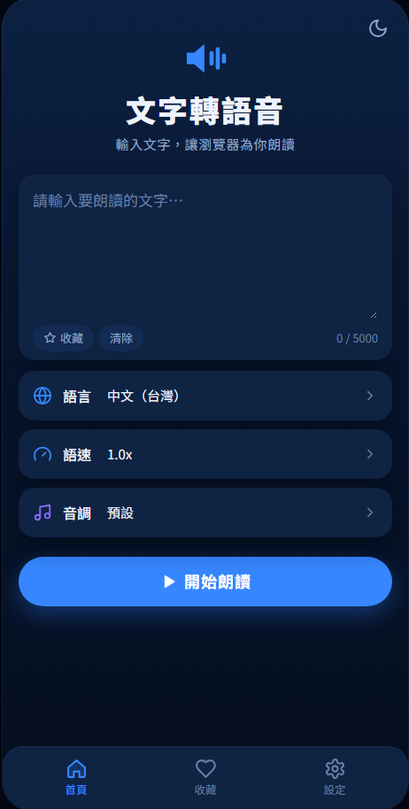

# 🔊 文字轉語音

輸入文字，讓瀏覽器為你朗讀。這是一個單一 HTML 檔案的網頁 App，不需要安裝、不需要伺服器，打開就能用。

**線上試用：** https://robbie0425.github.io/TextToSpeech/



## 功能

- **文字朗讀**：最多 5000 字，使用瀏覽器內建的語音合成（Web Speech API）
- **逐句朗讀**：自動依標點分段，朗讀時標示目前的句子；點文字裡任一句可以從那裡開始念
- **播放控制**：播放、暫停、上一句、下一句，進度條可以拖曳
- **語言與語音**：支援中文（台灣、香港、中國）、英文、日文、韓文，可以從裝置提供的語音中挑選並試聽
- **語速與音調**：語速 0.5x–2.0x、音調 -2 到 +2
- **收藏**：把常用的文字存起來並命名，之後一鍵播放或編輯
- **進階選項**：念完自動停止或重複播放、切換分頁時是否繼續朗讀
- **深色／淺色模式**

## 使用方式

### 直接在電腦上開啟

下載 `index.html`，用 Chrome、Edge 或 Safari 打開就能使用。

### 部署到 GitHub Pages

1. 確認儲存庫裡的檔案名稱是 `index.html`
2. 進入儲存庫的 **Settings → Pages**
3. 在 **Build and deployment** 的 Source 選 **Deploy from a branch**
4. Branch 選 `main`，資料夾選 `/ (root)`，按 **Save**
5. 等一到兩分鐘，頁面上方會出現網址：`https://你的帳號.github.io/你的儲存庫名稱/`

### 加入手機主畫面

用手機打開上面的網址，加入主畫面後就會像 App 一樣有自己的圖示。

- **iPhone**：用 Safari 開啟 → 分享按鈕 → 加入主畫面
- **Android**：用 Chrome 開啟 → 右上角選單 → 加入主畫面

## 鍵盤快速鍵

| 按鍵 | 動作 |
| --- | --- |
| 空白鍵 | 在朗讀畫面播放／暫停 |
| ← → | 進度條取得焦點時，往前或往後跳 5% |

## 瀏覽器支援

| 瀏覽器 | 支援狀況 |
| --- | --- |
| Chrome（電腦、Android） | ✅ 中文語音最多 |
| Edge | ✅ 提供高品質的線上語音 |
| Safari（Mac、iPhone、iPad） | ✅ |
| Firefox | ⚠️ 可以使用，語音取決於作業系統 |

## 注意事項

- **可用的語音由裝置和瀏覽器決定**，不同電腦或手機看到的語音清單會不一樣。
- 標示「**線上**」的語音會由瀏覽器連網產生聲音（例如 Chrome 的 Google 語音），文字會傳送到瀏覽器廠商的伺服器。只想在本機處理的話，請選擇沒有「線上」標籤的語音。
- **收藏和設定存在瀏覽器的 localStorage**。換瀏覽器、使用無痕模式或清除瀏覽資料後，收藏就會消失。
- 在手機上切換到其他 App 或鎖定螢幕時，系統可能會停止朗讀，這是瀏覽器的限制。
- 介面字型從 Google Fonts 載入，離線時會改用系統內建的中文字型，功能不受影響。

## 技術說明

- 純 HTML、CSS、JavaScript，沒有任何框架或建置步驟
- 語音：[Web Speech API — SpeechSynthesis](https://developer.mozilla.org/zh-TW/docs/Web/API/SpeechSynthesis)
- 儲存：`localStorage`
- 字型：[Noto Sans TC](https://fonts.google.com/noto/specimen/Noto+Sans+TC)

```
.
├── index.html   # 整個 App（HTML、CSS、JS 都在這個檔案裡）
└── README.md
```
